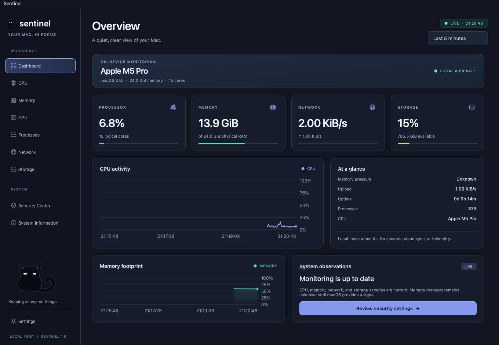

<p align="center"></p>

# Sentinel

A native system monitor for Apple Silicon Macs. Sentinel brings live CPU, memory, process, network, storage, and security configuration information into a quiet dark interface, with an original black cat keeping watch in the sidebar.

The interface includes responsive overview cards, color-coded activity graphs, keyboard navigation, and a process table that keeps its selection as live measurements change. Press **⌘1–⌘9** to move between pages, **⌘F** to search processes, or **⌘,** for Settings. Animation follows the app preference and macOS Reduce Motion; inactive and hidden charts pause their animation timers.

The monitoring engine is C++20 and Objective-C++. The interface uses Qt 6 Widgets with vector rendering. Measurements come from public macOS APIs; the application does not substitute generated values when a measurement is unavailable.



## Download

[Download the v1.0.0 preview for Apple Silicon](https://github.com/Unknown-George/Sentinel/releases/tag/v1.0.0). The release includes the standalone app, source, checksums, and corresponding Qt sources. This initial preview is ad-hoc signed and is not notarized; clean-machine testing on macOS 14.0 remains outstanding.

## What it does

| Page | Available information |
| --- | --- |
| Dashboard | Live CPU, memory, storage, network throughput, uptime, and activity history |
| CPU | Overall and per-core utilization, processor details, and time history |
| Memory | Physical, estimated used/available, wired, compressed, active/inactive/free, swap, and pressure notifications |
| GPU | Metal device name, unified memory capability, and recommended working set |
| Processes | Searchable, sortable live process list, CPU, resident memory, owner, PID, executable path, signing inspection, and permitted socket details |
| Network | Interface addresses, counters, rates, and bandwidth history |
| Storage | Mounted volumes, filesystem types, capacity, available space, and capacity history |
| Security Center | Read-only firewall, FileVault, Gatekeeper, and code-signing checks |
| System Information | Model, processor, cores, architecture, operating system, and physical memory |
| Settings | Sampling interval, history retention, animation preferences, and local history deletion |

There is no privileged helper, kernel extension, traffic interception, process termination, or cloud service. Security Center describes observable configuration; it does not certify a Mac as secure or scan for malware.

## Build

You need an Apple Silicon Mac, Apple's command-line developer tools, CMake 3.24+, a C++20 compiler, Qt 6 Core/GUI/Widgets/SVG, SQLite development headers, and GoogleTest for tests.

The application targets macOS 14.0 APIs. The supplied application and CI use the official Qt 6.8.3 SDK to retain macOS 14.0 compatibility. The deployment target alone cannot lower a prebuilt dependency's minimum version. Current Qt 6.12 officially requires macOS 14.4+, and Homebrew bottles can impose a substantially newer minimum for individual libraries. Inspect the actual deployed Mach-O metadata rather than assuming every bottle shares QtCore's minimum. Sentinel's package verifier checks every embedded binary against macOS 14.0 by default. See [Qt's platform support](https://doc.qt.io/qt-6/macos.html).

```sh
git clone https://github.com/Unknown-George/Sentinel.git
cd Sentinel
xcode-select --install
brew install cmake ninja googletest
python3 -m venv .venv
.venv/bin/pip install aqtinstall==3.3.0
.venv/bin/aqt install-qt mac desktop 6.8.3 clang_64 \
  --archives qtbase qtsvg --outputdir .qt-sdk
export QT_PREFIX="$PWD/.qt-sdk/6.8.3/macos"
cmake -S . -B build -G Ninja \
  -DCMAKE_BUILD_TYPE=Release \
  -DCMAKE_OSX_ARCHITECTURES=arm64 \
  -DCMAKE_OSX_DEPLOYMENT_TARGET=14.0 \
  -DCMAKE_PREFIX_PATH="$QT_PREFIX;$(brew --prefix googletest)" \
  -DSENTINEL_BUILD_TESTS=ON
cmake --build build --parallel
ctest --test-dir build --output-on-failure
open build/Sentinel.app
```

`aqtinstall` downloads the public Qt SDK archives; it is an independent installer. The official Qt installer can provide the same SDK. For an SDK installed elsewhere, set `QT_PREFIX` to its `macos` directory. CMake includes compatibility fixes for recent Apple SDKs when consuming older Qt headers and imported OpenGL link requirements. GoogleTest is discovered locally through CMake; configuring does not download or execute third-party source. A Homebrew Qt build is also possible for development, but its complete dependency minimum must be checked before distribution.

The UI and core build configuration are separated from the macOS collector. The shipped collector and application are macOS-specific; this repository does not pretend to provide live platform data on other operating systems.

## Measurements and limits

CPU percentages use differences between successive Mach tick counters, not cumulative time. The initial sample and counter resets are gaps. Overall CPU is normalized to 0–100%; a process using one entire core is 100%, so a multithreaded process can exceed 100%.

Memory used is an estimate derived from wired pages, physical compressor pages, and nonpurgeable internal pages. Available is total minus this estimate, representing reclaimable headroom, not a count of immediately free pages. Memory pressure is reported from system pressure notifications; it remains **Unknown** until an event has been observed. Full definitions are in [METRICS.md](docs/METRICS.md).

Apple does not expose a stable public API for total Apple Silicon GPU utilization or all device temperatures, fan speeds, and energy counters. Sentinel shows the supported Metal hardware information and an explanation for unavailable GPU utilization. Metal's recommended working set is a budget estimate, not GPU memory consumption or dedicated VRAM. Disk I/O throughput is not inferred from capacity changes. Interface rates are not per-process traffic attribution; VPNs and virtual interfaces can affect aggregate totals. Protected process data and socket inspection can be denied by macOS, and short-lived processes may disappear between calls.

The firewall, FileVault, and Gatekeeper checks run read-only system tools with bounded waits. A failed command or unrecognized result is **Unknown**, not a disabled security feature. Signing validity is checked against the code's own signature requirements; it is not an Apple notarization lookup, malware verdict, or blanket trust decision. No authentication prompt or privilege escalation is requested by the application.

## History and privacy

Collection happens on a worker thread. Live charts keep bounded point sets. Aggregate history is saved locally in SQLite every five seconds and downsampled in SQLite for long ranges. Retention is configurable up to 30 days and is applied at startup, when changed, and periodically while running. Preferences use the native Qt settings mechanism.

Only timestamps, CPU percentage, memory totals, bandwidth rates, and system disk capacity are stored in the history database. Process names, executable paths, users, network endpoints, and security results are not stored there. The database is `history.sqlite3` inside Qt's application-local data directory (normally `~/Library/Application Support/Sentinel/Sentinel/` on macOS); preferences use the `sentinel.app` domain. Clear History removes retained samples; collection continues afterward. No telemetry or network requests are made by the running application. Build tools may download dependencies independently.

## Package and release

```sh
bash scripts/package.sh build dist
```

With `QT_PREFIX` still set to the SDK used for building, this creates an ARM64 ZIP with the Qt frameworks and plugins deployed by `macdeployqt`, bundled license notices, and a SHA-256 checksum. The script verifies every Mach-O contains ARM64, checks dependency paths resolve inside the bundle or to macOS system libraries, rejects build-machine runtime search paths, checks minimum runtime versions, and validates the deep code signature. The default archive is ad-hoc signed for local execution; it is not Developer ID signed or notarized. Test it on a clean compatible Mac before publishing.

For an Apple Developer release, provide credentials from your local keychain or CI secrets:

```sh
DEVELOPER_ID='Developer ID Application: Your Name (TEAMID)' \
NOTARY_PROFILE='your-notarytool-keychain-profile' \
CREATE_DMG=1 \
bash scripts/package.sh build dist
```

`NOTARY_PROFILE` is optional and requires `DEVELOPER_ID`. Developer ID signing and notarization do not occur without those values. The script never stores credentials in the repository. `QT_PREFIX` selects the Qt directory containing `bin/macdeployqt`; `QT_ROOT_DIR` is also accepted for CI. `SENTINEL_MAX_DEPLOYMENT_TARGET` can override the verifier's 14.0 maximum only for an intentional newer-runtime build.

GitHub Actions builds ARM64 on `macos-15`, runs the unit tests and an offscreen live smoke test, then uploads an ad-hoc signed package for inspection. Uploading an artifact is not a public release. Review the [third-party notices](docs/THIRD-PARTY-NOTICES.md) before distributing a Qt bundle.

## Development

See [ARCHITECTURE.md](docs/ARCHITECTURE.md) for ownership and data flow, [METRICS.md](docs/METRICS.md) for formulas and semantics, [API-SOURCES.md](docs/API-SOURCES.md) for primary API references, and [VALIDATION.md](docs/VALIDATION.md) for performed checks and remaining release checks.

The supplied build passed all 12 unit tests and the live native smoke checks recorded in [VALIDATION.md](docs/VALIDATION.md). GoogleTest covers counter reset/zero-time behavior, normalized CPU calculations, process CPU core equivalents, SQLite round trips, null measurements, chronological bounded history queries, retention, deletion, database failures, and refusal to alter a newer database schema. Live smoke testing exercises the real collector; it does not install fixture data into the dashboard:

```sh
QT_QPA_PLATFORM=offscreen build/Sentinel.app/Contents/MacOS/Sentinel --smoke-test
QT_QPA_PLATFORM=offscreen build/Sentinel.app/Contents/MacOS/Sentinel \
  --capture-dir /tmp/sentinel-review --window-size 1000x700
python3 scripts/verify_bundle.py /path/to/deployed/Sentinel.app
```

Smoke/capture mode automatically uses temporary data and settings. An explicit `--data-dir` overrides both for repeatable inspection. Visual review, permission-denied behavior, reduced motion, resizing, suspend/resume, and clean-machine packaging should also be checked for each release.

Sentinel's original code and artwork are MIT licensed. Qt and other dependencies keep their own licenses.
